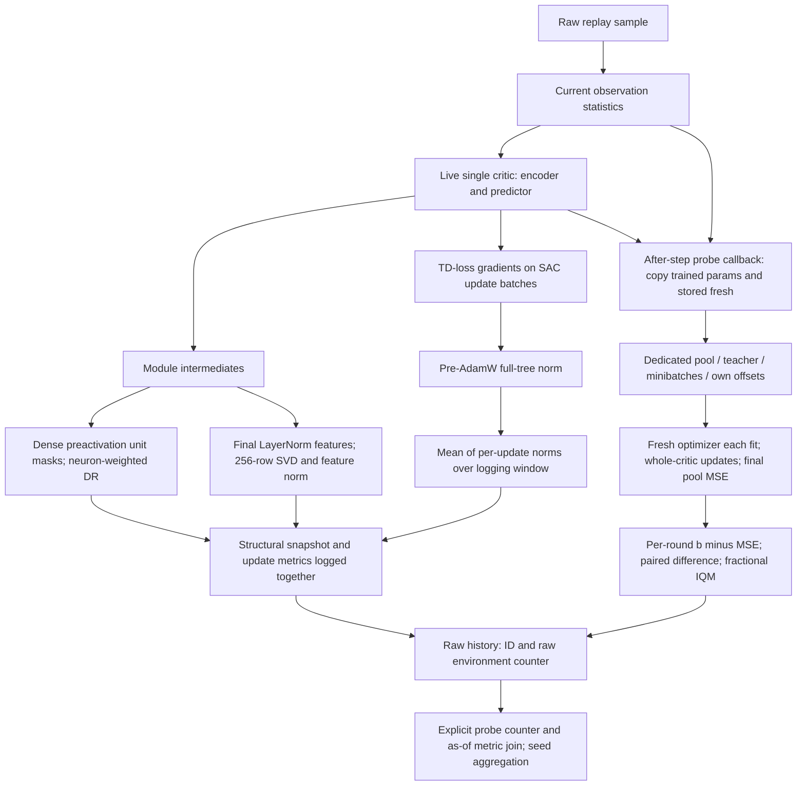

# Critic diagnostics versus adaptation probes: implementation audit

24 October 2026. Follow-up on [draft PR13](https://github.com/kaves29/scaling-drl-research/pull/13).
Historical campaign: `f597ee9898e4d401912092c336c3e5330cf2fda1`.
Current comparison: PR13 head before this report,
`2b1862167fb71ded30521df55cc6f74cdeea3526`.

## Finding

**No campaign implementation defect is established that explains the reported
architecture/environment disagreement.** The rank changes and probe values both
survive independent reconstruction. Their disagreement is not evidence by itself
that either calculation is wrong. There are confirmed logging/reporting defects,
important differences between what the metrics measure, and unverified runtime
questions. Those categories must remain separate.

This follow-up inspected original/current code and existing data only. No new
fit, model forward/gradient execution, training, simulator rollout or GPU work
was run. Production code, scientific definitions and archived data are unchanged.
Earlier synthetic controls in the [original audit](forensic_probe_audit_20261024.md)
are explicitly **prior evidence**, not newly run qualification under this request.
Candidate patches already in PR13 remain unapplied.

Inputs read: comprehensive `REPORT.md`, `DISCOVERY_LEDGER.md`, metric supplement
`FINDINGS.md` and analyzer source, original manifests/source, raw metadata/history
and existing per-round records. Input ZIP hashes are in the original audit;
this follow-up's receipt additionally hashes those three documents. The missing
`initial_reference_comparison/` source/PDF remains a limitation; raw anchors and
supplied aligned comparisons are available. Reports were treated as claims;
supplied scripts/pickle were not executed in this follow-up.

Fourteen source paths were compared byte-for-byte against the current tree.
**Thirteen are unchanged**, including critic construction, gradient calculation,
normalization, metrics, optimizer, probe, parameter routing and W&B logger.
The remaining file, `experiments/exp12/trainer.py`, adds PR11 opt-in provenance
observations and terminal-success attribution corrections; the metrics/probe
calculations below remain the historical ones. Later retrospective optimizer
corrections do not rewrite original in-training probes. PR12 is not merged here.

## Independent raw-record findings

All comparisons below use the same eight training seeds in each condition at
70% training. Rank/dormancy/gradient common70 values are per-run medians in
60–70%, then means across runs. Initial rank is the first structural snapshot
at interaction2,000, before SAC warmup; early gradient is median over10–20%.
Probe gap is exactly check35/350,000 interactions. A window summary and a
single checkpoint are **not simultaneous individual observations**. Initial
structural metrics at interaction2,000 and the fresh probe anchor at5,000 also
use different input/normalizer snapshots, even though both precede SAC updates.

| Environment | Critic | Initial rank | Rank60–70 | Rank down /8 | DRτ.2 (%) | TD gradient early→60–70 | Anchor gap70 |
| --- | --- | ---: | ---: | ---: | ---: | ---: | ---: |
| dog-run | D2W512 | 230.000 | 234.875 | 2 | 0.00222 | 0.36785→1.0365 | 0.127517 |
| dog-run | D4W1024 | 233.250 | 229.500 | 5 | 0.08167 | 0.72212→1.3281 | 0.002107 |
| dog-run | D4W1536 | 234.250 | 237.812 | 2 | 0.67856 | 1.0243→1.3252 | 0.002473 |
| humanoid-run | D2W512 | 229.500 | 230.688 | 4 | 0.35733 | 0.089815→0.33422 | 0.009653 |
| humanoid-run | D4W1024 | 233.125 | 219.938 | 7 | 2.10135 | 0.1334→0.40658 | 0.003637 |
| humanoid-run | D4W1536 | 234.250 | 201.750 | 8 | 1.59408 | 0.15726→0.53313 | 0.002457 |
| myo-key-turn | D2W512 | 229.250 | 200.750 | 8 | 0.01887 | 70.021→85.294 | 0.654111 |
| myo-key-turn | D4W1024 | 232.375 | 172.875 | 8 | 0.52897 | 69.811→66.204 | 0.529309 |
| myo-key-turn | D4W1536 | 233.250 | 167.000 | 8 | 1.26604 | 63.623→56.121 | 0.608143 |
| myo-pen-twirl | D2W512 | 226.250 | 190.312 | 8 | 0.30185 | 9712.4→22031 | 7.525899 |
| myo-pen-twirl | D4W1024 | 229.250 | 109.625 | 8 | 2.96050 | 3815.3→4502.5 | 0.855016 |
| myo-pen-twirl | D4W1536 | 230.250 | 94.688 | 8 | 2.19397 | 14235→25846 | 3.086220 |

The raw check tool verifies **2,784** values against the supplement's per-seed
summary, with no mismatches. It also checks metric ranges/threshold ordering and
**23,512** exact q1/q2 matches; those labels represent one critic. Structural
metrics have23,704 finite observations each; gradient/TD/Q metrics have23,512.
There are no nonfinite numeric entries or invariant errors in the checked metric
fields. Explicit nulls and absent fields remain missing, not zeros.

These observations establish:

- Large dog: rank234.25→237.8125, later dormancy .67856%, lower than its early
  value in8/8 seeds. There is no group-level rank-collapse premise to explain.
- Large humanoid: rank234.25→201.75, lower in8/8 seeds, while the probe gap to
  the initial reference is .0024575 at70%. However, its logged gradient grows
  .15726→.53313 in8/8 seeds, and dormancy declines5.06863%→1.59408% in8/8.
  Persistent rank reduction coexists with recovery in other diagnostics;
  the evidence does not show universal collapse in all diagnostic signals.
- All48 Myo runs have lower common70 rank than initial. In pen-twirl, mean
  rank reduction is35.9375/119.625/135.5625 for small/medium/large, but anchored
  probe gaps are7.52590/.85502/3.08622. The different size rankings are real
  recorded measurements; no monotonic link between rank and fitting endpoint
  follows from their definitions.

These summaries reproduce descriptive claims, not their causal interpretation.
The stored48 Myo rank reductions do not show that the same units became inactive,
that rank loss is irreversible, or that reward learning necessarily worsened.

## Exact call paths and source references

All S-links bind the original full campaign SHA, not a mutable branch. See also
[the complete probe dataflow/units map](forensic_probe_dataflow.md).

| Ref | File / original lines | Inspected behavior |
| --- | --- | --- |
| S1 | [sac_network.py:17](https://github.com/kaves29/scaling-drl-research/blob/f597ee9898e4d401912092c336c3e5330cf2fda1/main/scale_rl/agents/sac/sac_network.py#L17), [74](https://github.com/kaves29/scaling-drl-research/blob/f597ee9898e4d401912092c336c3e5330cf2fda1/main/scale_rl/agents/sac/sac_network.py#L74) | Residual encoder, final LayerNorm, linear predictor; Q uses concatenated observations/actions and all learned layers. |
| S2 | [layers.py:31](https://github.com/kaves29/scaling-drl-research/blob/f597ee9898e4d401912092c336c3e5330cf2fda1/main/scale_rl/networks/layers.py#L31) | LayerNorm→expanded Dense→functional ReLU→contracted Dense→residual sum. |
| S3 | [sac_update.py:199](https://github.com/kaves29/scaling-drl-research/blob/f597ee9898e4d401912092c336c3e5330cf2fda1/main/scale_rl/agents/sac/sac_update.py#L199), [267](https://github.com/kaves29/scaling-drl-research/blob/f597ee9898e4d401912092c336c3e5330cf2fda1/main/scale_rl/agents/sac/sac_update.py#L267) | Capture module intermediates; flatten recursively; single-critic DR/feature norm/rank/weight norm fields. |
| S4 | [metrics.py:88](https://github.com/kaves29/scaling-drl-research/blob/f597ee9898e4d401912092c336c3e5330cf2fda1/main/scale_rl/networks/metrics.py#L88), [143](https://github.com/kaves29/scaling-drl-research/blob/f597ee9898e4d401912092c336c3e5330cf2fda1/main/scale_rl/networks/metrics.py#L143), [237](https://github.com/kaves29/scaling-drl-research/blob/f597ee9898e4d401912092c336c3e5330cf2fda1/main/scale_rl/networks/metrics.py#L237) | Exact dormancy/feature-norm/singular-count definitions. |
| S5 | [sac_update.py:58](https://github.com/kaves29/scaling-drl-research/blob/f597ee9898e4d401912092c336c3e5330cf2fda1/main/scale_rl/agents/sac/sac_update.py#L58), [trainer.py:88](https://github.com/kaves29/scaling-drl-research/blob/f597ee9898e4d401912092c336c3e5330cf2fda1/main/scale_rl/networks/trainer.py#L88), [utils.py:11](https://github.com/kaves29/scaling-drl-research/blob/f597ee9898e4d401912092c336c3e5330cf2fda1/main/scale_rl/networks/utils.py#L11) | Critic TD gradient over all dense params, norm before AdamW, return new functional Trainer. |
| S6 | [Exp12 trainer.py:167](https://github.com/kaves29/scaling-drl-research/blob/f597ee9898e4d401912092c336c3e5330cf2fda1/main/experiments/exp12/trainer.py#L167), [183](https://github.com/kaves29/scaling-drl-research/blob/f597ee9898e4d401912092c336c3e5330cf2fda1/main/experiments/exp12/trainer.py#L183), [203](https://github.com/kaves29/scaling-drl-research/blob/f597ee9898e4d401912092c336c3e5330cf2fda1/main/experiments/exp12/trainer.py#L203) | SAC updates precede structural snapshot; pending update metrics flush; logging reset; then after_step probe callback. |
| S7 | [normalization.py:73](https://github.com/kaves29/scaling-drl-research/blob/f597ee9898e4d401912092c336c3e5330cf2fda1/main/scale_rl/agents/wrappers/normalization.py#L73), [sac_agent.py:615](https://github.com/kaves29/scaling-drl-research/blob/f597ee9898e4d401912092c336c3e5330cf2fda1/main/scale_rl/agents/sac/sac_agent.py#L615) | Normalize sample before metrics; live actor/critic passed to metric functions, no cached prior parameter snapshot. |
| S8 | [angle_1.py:88](https://github.com/kaves29/scaling-drl-research/blob/f597ee9898e4d401912092c336c3e5330cf2fda1/main/experiments/angle_1.py#L88), [logger.py:78](https://github.com/kaves29/scaling-drl-research/blob/f597ee9898e4d401912092c336c3e5330cf2fda1/main/scale_rl/common/logger.py#L78), [149](https://github.com/kaves29/scaling-drl-research/blob/f597ee9898e4d401912092c336c3e5330cf2fda1/main/scale_rl/common/logger.py#L149) | Device metrics replayed per update in order; equal update weight in logging-window means; structural snapshot once per logging event. |
| S9 | [run_probes.py:27](https://github.com/kaves29/scaling-drl-research/blob/f597ee9898e4d401912092c336c3e5330cf2fda1/main/experiments/exp12/run_probes.py#L27), [67](https://github.com/kaves29/scaling-drl-research/blob/f597ee9898e4d401912092c336c3e5330cf2fda1/main/experiments/exp12/run_probes.py#L67), [77](https://github.com/kaves29/scaling-drl-research/blob/f597ee9898e4d401912092c336c3e5330cf2fda1/main/experiments/exp12/run_probes.py#L77) | Fresh restore/capture and trained critic selection; network/params are supplied separately. |
| S10 | [probe.py:65](https://github.com/kaves29/scaling-drl-research/blob/f597ee9898e4d401912092c336c3e5330cf2fda1/main/experiments/exp12/probe.py#L65), [78](https://github.com/kaves29/scaling-drl-research/blob/f597ee9898e4d401912092c336c3e5330cf2fda1/main/experiments/exp12/probe.py#L78), [116](https://github.com/kaves29/scaling-drl-research/blob/f597ee9898e4d401912092c336c3e5330cf2fda1/main/experiments/exp12/probe.py#L116), [150](https://github.com/kaves29/scaling-drl-research/blob/f597ee9898e4d401912092c336c3e5330cf2fda1/main/experiments/exp12/probe.py#L150) | Teacher, fixed target/offset per fit, dynamic parameter arguments, scan updates, paired keys and pools. |
| S11 | [probe.py:40](https://github.com/kaves29/scaling-drl-research/blob/f597ee9898e4d401912092c336c3e5330cf2fda1/main/experiments/exp12/probe.py#L40), [174](https://github.com/kaves29/scaling-drl-research/blob/f597ee9898e4d401912092c336c3e5330cf2fda1/main/experiments/exp12/probe.py#L174), [run_probes.py:111](https://github.com/kaves29/scaling-drl-research/blob/f597ee9898e4d401912092c336c3e5330cf2fda1/main/experiments/exp12/run_probes.py#L111) | IQM, paired score difference, round and summary persistence/logging. |
| S12 | Supplement `analyze.py:19–24,33–43,50–67`; full file SHA256 `a71f98ec79797c8119180514d7a25cb4e86f965778c6f203b91d3c62e72e722f` | Window/first-value definitions, finite-filtered bootstrap, nominal n label, observed-time plots and as-of alignment. The full uploaded source is retained outside Git; exact aggregation excerpt/hash is tracked with PR13. |

The structural minibatch has256 samples; probe pool has25,600 samples with
replacement. They are not the same input set. Structural sampling uses the
training buffer's existing sampling path; the probe has a dedicated stream.
Changing/disabling structural logging could change training sampling RNG
consumption; no such change is adopted. Asynchronous device transfer alone does
not select a different critic: functional JAX arrays returned by each update
are passed to the snapshot, and pending gradient arrays are replayed before
logging. This is source evidence, not inspection of missing production weights.

## Ranked measurement limitations

| Priority / relevance | Expected versus actual, affected conditions | Could explain the observed pattern? | Minimal verification / comparability consequence |
| --- | --- | --- | --- |
| High: metrics answer different questions (S1–S8) | A healthy/poor representation proxy does not define the endpoint of whole-network finite-budget sine-task fitting. Rank/DR exclude the scalar predictor; gradient is a TD-loss gradient, not probe gradient or AdamW displacement. All96 runs. | Explains why disagreement is possible; does not determine why a particular size recovers. | Inspect saved full-pool fitting errors/first-update displacement if retained. If absent, propose separately approved fixed-task diagnostics; no new fitting now. |
| High: DR hook population (S2–S4) | If interpreted as dead post-ReLU units, expected postactivation inactivity; actual statistic uses Dense module outputs before functional ReLU, also projection and contracted branch, excluding predictor. Masks concatenated: unit-weighted, not equal layer average. | Can invalidate an argument based on “low DR means no dead nonlinear units.” Cannot establish actual dead units in these runs. | Proposed forward-only CPU fixture with negative nonzero preactivations/zero ReLU outputs, or inspect existing saved activations. Post-ReLU instrumentation would be a new measurement and requires approval; retain historical DR. Prior audit already has synthetic counterexample, not rerun here. |
| High: rank meaning/ceiling (S1,S3,S4) | Expected by a casual `srank` reading might be stable rank; actual smallest k explaining99% **sum of singular values**, uncentered, final LayerNorm features, max256 for every width. All conditions; strong interpretation relevance in wide DMC/Myo. | A falling count need not mean exact rank loss, frozen parameters or inability to adapt. Ceiling can hide width-dependent variation; it does not make humanoid's decline a bookkeeping error. | Proposed no-fit CPU matrices with known spectra distinguish stable rank, energy rank and this count; check zero-matrix convention1. Relabeling preserves numbers; changing definition/centering changes scientific comparability and is not adopted. |
| High: time/distribution mismatch (S6–S8,S10,S12) | Expected simultaneous fixed-input comparison; actual window-averaged gradients, one-batch structural snapshots and after-step probe on another pool. Current normalizer/replay evolve. | Confounds interpretation in all environments; does not predict all48 Myo rank declines or all96 fresh declines. | Existing as-of joins checked; recover stored inputs/statistics before any forward-only matched-input check. A fixed-reference representation metric would be new methodology. |
| Medium: endpoint can conceal slower early adaptation (S10) | A2,000-step endpoint does not measure speed at100/1,000 steps. Existing curves are pre-update varying-minibatch losses, not intermediate full-pool loss. | Plausible for large DMC recovery, **unverified**; no original DMC fitting curves/params in these ZIPs. | Search retained original arrays first. The single Myo NPZ cannot resolve large-DMC kinetics. New fits or intermediate-pool instrumentation require separate authorization. |
| Medium: target comparability (S9–S10) | Same pair gets inputs/base/minibatches but own offsets, hence different literal final targets and potentially initial difficulty. Across checks: replay, normalizer, teacher and keys change; across sizes teacher architecture changes. | Allows fresh drift and trained advantage; insufficient to explain direction/magnitude or causal size effect. | Recover existing targets/teacher/inputs. Compute initial centered Q variance/covariance without fitting. Changing target scaling/teacher/offset would change the experiment; no correction adopted. |
| Medium: normalization/norm units (S1,S4,S5) | Feature norm after LayerNorm; global gradient L2 before optimizer, all dense parameter leaves including norms/head. Not a layerwise or update-space statistic. | Can reconcile rank reduction with large/noncollapsing gradient norms; no causal explanation of probe deficit from raw gradient size. | Inspect existing per-layer gradients/update artifacts if present. Proposed no-fit array norm checks only; no clipping/normalization/rescaling changes. |

For D residual blocks of width W, the DR population has `W + D*(4W+W)`
units:5,632 for D2W512;21,504 for D4W1024;32,256 for D4W1536. Thus the expanded
branch has a different fraction of the population for D2 versus D4. Depth and
width also change which activations are being summarized. A low aggregate does
not certify every layer or a fixed set of neuron identities is active.

## Confirmed defects and actionable reporting issues

| Severity / source | Expected → actual | Scope / explanatory relevance | Minimal proposed fix and consequence |
| --- | --- | --- | --- |
| Medium, S11 `run_probes.py:133–141` | Contemporary marginal score summaries at each check → W&B fresh marginal IQM logged only initially; round arrays still logged. | All canonical nonzero checks. **Not the cause** of supplied fresh drift: supplement reconstructs current fresh IQM from rounds. | Existing unapplied `contemporary_score_logging.patch` adds marginal IQMs; no fit/definition change, historical values untouched. |
| Low, S12 `analyze.py:33–43` | Effective n for each metric/window → nominal8 reused in architecture summary even where finite-filtered late estimators use7. |18 late-summary rows (nine metrics, dog-large/key-large). Common70 remains n8; cannot explain the reported disagreement. | Existing unapplied `late_effective_n.patch` adds per-window finite n without changing estimators. Correct uncertainty/sample-count interpretation, not historical measurements. |
| Integration, PR11 `analysis/campaign/pipeline.py` grouping | Recognize coupled top/agent/env seeds as replicates → only top-level seed removed from key; native export mapping also unqualified. | Future PR11 ingestion, not supplement's separate analysis or recorded phenomena. | Existing unapplied grouping proposal plus reviewed schema/provenance adapter. Future group membership/CI changes; do not count pilot pairs twice or fabricate clean-worktree provenance. |

These verified defects do not establish a faulty original trained-versus-fresh
parameter route, rank computation or fitting score. They are retained separately
from the most explanatorily relevant measurement limitations above.

## Plausible unverified issues and smallest missing evidence

| Issue | Evidence for / against | Affected scope and smallest next step |
| --- | --- | --- |
| Runtime wrong/stale checkpoint or parameter tree | Source selects live trained and stored fresh; prior synthetic routes preserve distinguishable output/head/normalizer/optimizer state. One original NPZ has distinct offsets and score binding. Actual parameter hashes/manifests absent. | Cannot certify any unprovided original checkpoint. Obtain existing live/fresh weights, state LATEST/manifest, config and run ID for matched DMC/Myo checks, then compare hashes/forward predictions only. |
| Capacity/conditioning/initial residual variation | All layers train during the probe, so new fitting can recover after a representation statistic falls. Own-offset initial residual depends on centered Q variation/covariance, not mean Q alone. No original per-layer/initial-pool arrays. | Could contribute to humanoid recovery and Myo rankings; current evidence does not separate them. Inspect original predictions/residuals/gradients before considering a new fit. |
| Float32 target addition / high sine sensitivity | Source uses `a+sin(1e5*f)` in float32. Prior extreme-offset2^24 fixture loses variation; original Myo example mean≈2,000 is a counterexample to assuming that extreme fixture represents the campaign. | Campaign magnitude/architecture relevance unestablished. Obtain literal base/target arrays and compute ULP/residual differences at actual offsets without updating parameters. Any arithmetic change requires approval. |
| GPU execution discrepancy | Original later A100 segmented reconstruction failed existing acceptance criteria; CPU controls do not qualify GPU. Original campaign itself uses continuous scan. | Cannot use this later failure as proof original scores are corrupt. Matched-input/source A100 qualification needs separate authorization; do not loosen criteria. |
| Identical preprocessing in actual original execution | Source normalizes raw replay once for both and teacher, using current statistics. No BatchNorm running state/dropout/train-eval flag in this critic; LayerNorm uses per-example computation. Actual pools/statistics absent. | Recover existing normalized inputs/statistics. Do not infer runtime identity from source alone. |

## Inspected paths without an established defect; evidence against leading hypotheses

| Hypothesis | Evidence against it / bounded conclusion |
| --- | --- |
| Compiled closure holds fresh params instead of current | `_fit` JIT static args are network definition, optimizer transform and chunk; params, pool, targets and indices are dynamic arguments. `loss_fn(p)` and final `predict(fitted)` use the supplied evolving tree. No trained/fresh parameter-value cache found (S9–S10). Actual original checkpoint identity still missing. |
| Probe mutates training or reuses previously fitted probe params | Functional scan initializes from each supplied tree with `tx.init(params)` each fit; fitted tree is not assigned to training/fresh or persisted as next fit initialization. RunProbes passes live critic and stored fresh each check (S9–S10). Prior hash controls are supporting synthetic evidence only. |
| Fewer than2,000 updates or optimizer reset after1,000 | Recorded configs have steps2,000; concatenated index shape2,000 feeds one scan carrying params/state. First1,000 indices use original key; next1,000 use fold_in(...,1). No early-stop branch or second reset (S10). NPZ has ten2,000-point curves in one real Myo case. |
| Wrong optimizer in original campaign | Archived configs and source agree on AdamW1e-4/.01, fresh state per probe fit, beta defaults. The later retrospective3e-4/0 regression is not original campaign source. Exact installed original package bodies remain unavailable. |
| Wrong head, dropped residual branches, mode mismatch | `SACCritic` concatenates inputs, executes full encoder and predictor; RunProbes uses live network definition/params (S1,S9). Canonical flags: single critic, no injection, no sparsity, no mixed precision. LayerNorm has no running train/eval statistics. |
| Near-zero score denominator, hidden normalization or clipping | P is **variance minus MSE**, with no denominator. Probe targets are not normalized by variance; no score clipping/broadcast substitution was found. DR separately has1e-9 in layer mean denominator, so it is not an unguarded zero division (S4,S10–S11). |
| Wrong pair sign, IQM, axis or last minibatch used as score | FP32 paired fresh-current scores then source ten-round fractional IQM agree with raw records. Scores use post-fit full-pool loss, not last pre-update minibatch. Prior reconstruction4,834 points/52,214 comparisons and original NPZ exact arithmetic support this; no new fits run. |
| All diagnostic signals collapse while large DMC probe stays flat | Raw large dog rank stays high; large humanoid rank falls but gradient increases/dormancy declines in8/8. Probe is not claimed flat throughout: early deterioration/recovery is retained. This contradicts the stronger universal-collapse premise, not the narrower reported rank/probe disagreement. |
| Crash filling, duplicate seeds or log-step join generates common70 pattern | All96 canonical runs reach70%; pilot pairs excluded, unique IDs used. No post-crash fill; explicit probe counters and bounded as-of joins used. Late n6/n7 limitations do not explain n8 common70 results. |

## Validation, proposals and remaining limits

Newly executed: raw JSON/manifest reader and independent diagnostic summaries,
2,784 published-value checks,23,512 q-label comparisons, metric invariants,
14 source-blob comparisons, Black/Pyflakes/compile checks on the new audit reader.
No pytest suite or prior fitting control was rerun under this request. Previous
15-test and GPU-unqualified CPU controls are cited with their original scope.
The reader's first draft had an audit-only missing-key error; it was corrected
to compute the anchor explicitly as raw check0 fresh IQM minus check35 current
IQM. No production defect was inferred from that reader error. Its failed log
is preserved; only the successful final receipt is reported as validation.

Reproduction tool: `main/audits/echocritic_forensic/diagnostic_review.py`.
Machine-readable results: adjacent `diagnostic_review_receipt.json`; full CSVs/logs
outside Git in `/workspace/artifacts/forensic-probe-audit-20261024/diagnostic-review-final/`.
The prior audit's32-epsilon reference reduction bound is reused unchanged;
no original scientific acceptance rule was changed.

The smallest useful next evidence is an **existing matched-check artifact bundle**:
trained/fresh parameter trees and manifests, raw pool/actions, normalizer snapshot,
teacher/base/targets, minibatch indices and any retained initial/intermediate
full-pool errors for a small/large DMC pair and one Myo case. That permits identity,
preprocessing, target precision and residual checks without new fitting. If it
was never retained, a claim about exact production routing or early-learning
kinetics cannot be completed from these ZIPs. Any fixed-task cross-evaluation,
new probe trajectory, new metric definition or GPU qualification must be
separately authorized; none is adopted or executed here.
