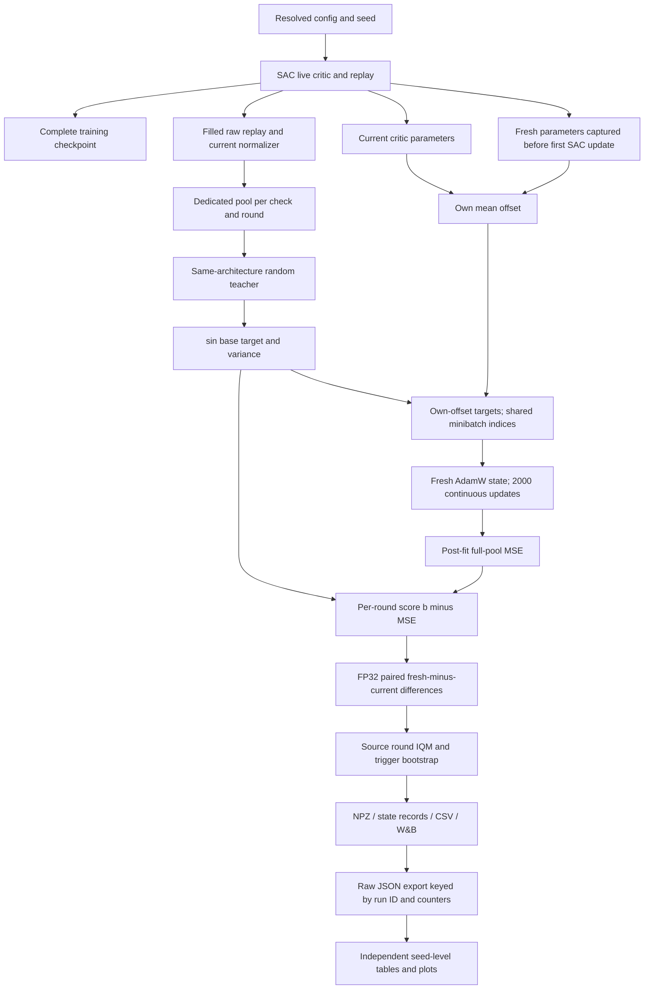

# Source-linked probe measurement path

Companion to [the audit](forensic_probe_audit_20261024.md). Unless explicitly
marked otherwise, links bind the **original campaign f597ee9**. Current source
and isolated fixtures do not establish original production checkpoint identity.

## Transitions and ownership

| Transition | Immutable source / function | Shape, dtype, counter and ownership |
| --- | --- | --- |
| Config → identities | [Exp1 compose/run](https://github.com/kaves29/scaling-drl-research/blob/f597ee9898e4d401912092c336c3e5330cf2fda1/main/experiments/exp1.py#L53), [campaign scheduler](https://github.com/kaves29/scaling-drl-research/blob/f597ee9898e4d401912092c336c3e5330cf2fda1/main/scripts/exp96_campaign.py) | Environment, architecture and seed are distinct identity fields; raw ID is authoritative for exports. Resolved top/agent/env seeds are coupled; do not group by display name or count their variations as three independent factors. |
| Construction → SAC updates | [SAC initialization](https://github.com/kaves29/scaling-drl-research/blob/f597ee9898e4d401912092c336c3e5330cf2fda1/main/scale_rl/agents/sac/sac_agent.py#L87), [update](https://github.com/kaves29/scaling-drl-research/blob/f597ee9898e4d401912092c336c3e5330cf2fda1/main/scale_rl/agents/sac/sac_update.py#L58) | Float32 actor and single critic; observation/action batch axes preserved, scalar Q per row. Actor/critic/temperature own parameters and optimizer states; target critic initialized from same critic key. Historical mask-shape initialization uses another temporary tree; canonical sparsity is zero. SAC update counter is not W&B `_step`. |
| Raw interaction → replay | [trainer.train](https://github.com/kaves29/scaling-drl-research/blob/f597ee9898e4d401912092c336c3e5330cf2fda1/main/experiments/exp12/trainer.py#L139), [NpyUniformBuffer](https://github.com/kaves29/scaling-drl-research/blob/f597ee9898e4d401912092c336c3e5330cf2fda1/main/scale_rl/buffers/numpy_buffer.py) | Raw float32 `(occupancy, obs_dim)`/`(occupancy, action_dim)` arrays; valid occupancy bounds used. Original trainer retains raw observations separately while action wrapper replaces timestep's next-observation entry with a normalized array. Terminal final observation replaces auto-reset observation in buffer. Synthetic four-transition actual-trainer control confirms raw replay, zero SAC updates. |
| Checkpoint capture/restore | [trainer/state](https://github.com/kaves29/scaling-drl-research/blob/f597ee9898e4d401912092c336c3e5330cf2fda1/main/experiments/exp12/state.py#L26), [agent serialization](https://github.com/kaves29/scaling-drl-research/blob/f597ee9898e4d401912092c336c3e5330cf2fda1/main/scale_rl/agents/sac/sac_agent.py) | LATEST points to committed state directory; trainer stores counters, replay, RNG, env state, normalization and extra probe records. Agent stores parameters, target, optimizer and agent key. Restore failure raises; no source fallback from failed restore to fresh params was found. Actual campaign checkpoint files are absent. |
| Trained/fresh selection | [RunProbes.current_critic/capture_fresh](https://github.com/kaves29/scaling-drl-research/blob/f597ee9898e4d401912092c336c3e5330cf2fda1/main/experiments/exp12/run_probes.py#L67) | Trained is unwrapped live SAC critic. Fresh captured at replay warmup before first SAC update, persisted separately; existing check0 record prevents recapture. Functional updates return new parameter trees. Synthetic restoration checks deliberately different full-network outputs and optimizer sentinels. Canonical runs have no injected critic or twin head. |
| Replay → normalized pool | [sample_pool](https://github.com/kaves29/scaling-drl-research/blob/f597ee9898e4d401912092c336c3e5330cf2fda1/main/experiments/exp12/probe.py#L103), [normalizer](https://github.com/kaves29/scaling-drl-research/blob/f597ee9898e4d401912092c336c3e5330cf2fda1/main/scale_rl/agents/wrappers/normalization.py) | 25,600 samples with replacement from filled replay; actions stay in training action coordinates. Current statistics normalize sampled observations once without updating stats. Both learners and teacher receive same processed pool. NumPy advanced indexing yields copies; sample/fit does not mutate replay. |
| Keys → teacher/base | [base_targets](https://github.com/kaves29/scaling-drl-research/blob/f597ee9898e4d401912092c336c3e5330cf2fda1/main/experiments/exp12/probe.py#L66), [probe_key/rng](https://github.com/kaves29/scaling-drl-research/blob/f597ee9898e4d401912092c336c3e5330cf2fda1/main/experiments/exp12/probe.py#L150) | Dedicated stream `0x50524F42`; JAX fold-in seed→stream→check→round, then split teacher/index keys. NumPy pool stream uses same tuple in default_rng, not global training generator. Random teacher initialized once per round with original architecture; base `z=sin(1e5*f)` float32 `(25600,)`, b=population variance over pool. High frequency amplifies changes in f; it is approved construction, not a bug by itself. |
| Parameters → own targets | [probe_round/_fit](https://github.com/kaves29/scaling-drl-research/blob/f597ee9898e4d401912092c336c3e5330cf2fda1/main/experiments/exp12/probe.py#L78) | Each learner gets fixed scalar `a=mean(q_initial(pool))` and fixed literal target `a+z`. Offset/target are constructed before differentiation and unchanged through fit; teacher is not updated. Shared-offset sensitivity option exists but is not canonical setting. Equal base/variance does not imply equal final targets or initial residual energy. Float32 literal addition can lose tiny variation at extreme offsets (separate proposal). |
| Index generation → updates | [probe_round](https://github.com/kaves29/scaling-drl-research/blob/f597ee9898e4d401912092c336c3e5330cf2fda1/main/experiments/exp12/probe.py#L116), [critic_optimizer](https://github.com/kaves29/scaling-drl-research/blob/f597ee9898e4d401912092c336c3e5330cf2fda1/main/experiments/exp12/probe.py#L212) | Integer `(2000,256)` indices; first 1,000 from original index key, next 1,000 from fold_in(index_key,1). Same order within pair. Fresh AdamW state per learner/round; all dense learner leaves differentiable, no mask/frozen branch in canonical run. One continuous lax.scan carries params/state; losses are sampled **before** each update. Source-copied scalar and residual fixtures check actual updates/fitted final evaluation. |
| Fitted params → score | [fit final evaluation / probe_round](https://github.com/kaves29/scaling-drl-research/blob/f597ee9898e4d401912092c336c3e5330cf2fda1/main/experiments/exp12/probe.py#L78) | Full 25,600 pool after update 2,000, chunk size2,560; MSE float32. Score `b−MSE`, not curve[-1]. Output stacks `(rounds,)` scores/offsets/b/final and `(rounds,steps)` minibatch curves. Host transfer occurs after rounds. |
| Scores → paired IQM / CI | [summarize](https://github.com/kaves29/scaling-drl-research/blob/f597ee9898e4d401912092c336c3e5330cf2fda1/main/experiments/exp12/probe.py#L174), [trigger](https://github.com/kaves29/scaling-drl-research/blob/f597ee9898e4d401912092c336c3e5330cf2fda1/main/experiments/exp12/trigger.py) | Pair float32 fresh-current before float64 IQM. Ten-round IQM weights sorted ranks3/8 by.1 and ranks4–7 by.2. Historical five-round source removes one low/high and averages three. CI resamples paired rounds with seed/check-bound bootstrap; trigger requires strict lower bound>0 and consecutive eligible checks. Per-round bootstrap is not seed-level inference. |
| Persistence → W&B | [record_check](https://github.com/kaves29/scaling-drl-research/blob/f597ee9898e4d401912092c336c3e5330cf2fda1/main/experiments/exp12/run_probes.py#L111) | State records/CSV hold marginal IQMs; W&B nonzero checks log round scores and loss IQM, omitting contemporary marginal IQMs. Fresh summary therefore stays at check0. NPZ persists full curves. Rows can have explicit nulls. Warmup check0 at interaction5,000/raw10,000 is carried by `_step`8,000; use explicit probe counters for alignment. Nonzero checks use scheduled counters. |
| Export → table → plot | [independent reader](../audits/echocritic_forensic/evidence.py), [statistical checks](../audits/echocritic_forensic/statistics_checks.py), [plots](../audits/echocritic_forensic/plots.py) | Original ID + recorded commit classify pilot/campaign, no display-name stitching. Reconstruct from finite round arrays. Probe interaction counter and train `_step`/action_repeat align units; metric as-of joins bounded at2,000 interactions. No filling missing checks. Per-run comparisons before seed aggregation. Plot lines connect observed checks without smoothing; baseline uses same observed IDs at each point. |

## Metric definitions and caveats

| Quantity | Definition / units | Caveat checked |
| --- | --- | --- |
| Per-round P | `Var(z) − mean_pool((q_fitted−(a+z))²)`; squared target-output units | Upper bound b, can be negative without lower bound. No division by b or clipping. |
| Contemporary L | IQM over paired `P_fresh,r − P_current,r` | Positive means current fits worse on this paired protocol; marginal IQM subtraction differs. Max observed nonadditivity .05249; provided score analysis uses correct pairing. |
| Initial anchor comparison | `P0 − contemporary current IQM`, computed within run | Cross-task descriptive anchor, not a same-input causal plasticity control; no current at check0. |
| train/critic_loss, td_error_var | SAC TD residual MSE/variance on sampled training batches | Not sine-task fitting losses; first finite values occur at interaction6,000. |
| q1_mean/q2_mean | Mean Q on training batch | `critic_use_cdq=false` assigns both to the same prediction; they are duplicate labels, not two independent critics or zero placeholders. |
| critic_DR0.1 /0.2 | Percentage of captured Dense preactivation units with normalized mean absolute output≤threshold; predictor excluded | Recursively includes input projection and residual Dense branches; not just projection, not all post-ReLU units. Denominator includes1e-9, so zero-denominator hypothesis is contradicted. |
| critic_srank | Uncentered feature matrix singular-value count capturing99% sum | Batch cap256; not stable rank/algebraic rank; zero matrix convention1. |
| critic_fnorm | Mean sample L2 of final encoder output | After final LayerNorm; scale near sqrt(width) can follow parameterization rather than representational growth. |
| critic_wnorm /gnorm | Parameter L2 / training critic gradient L2 | Different units and sample timing from adaptation fit displacement. |
| Metric “initial” | First finite value **of each metric** | DR/rank/norm at interaction2,000 (warmup); gradient/TD/Q at6,000 (after learning). Not a single universal initialization measurement. |
| Return/seed summaries | Unsmoothed observed evaluations; seed-level endpoint/window/AUC estimands, separately bootstrapped across seeds | No pilot duplicate replication; common70 n8; terminal/late effective n can fall. Do not use repetition bootstrap as independent seed replication. |

## Source/configuration difference matrix

| Path | DMC | Myo | Consequence / decisive discriminator |
| --- | --- | --- | --- |
| Wrapper/environment | dm_control task wrapper; maximum1,000 | seeded Myo wrapper; TimeLimit100 | Different physical tasks/termination; inspect original final-observation flags to evaluate a specific transition. Existing success-attribution correction changes labels, not probe source. |
| Discount / reward | .99 / reward_scale1 | .95 / reward_scale1 | Intended horizon heuristic; changes SAC Q distribution, not direct sine target formula. Inspect actual centered predictions and residuals. |
| Action repeat / budget | 2 / 1M raw steps | 2 / 1M raw steps | Both500k interactions,50 checks,10 rounds. No environment-dependent probe budget found. |
| Observation/action sizes | Task-specific | Task-specific | Source derives dimensions from actual spaces, not environment-name hardcoded slices. Actual original shape arrays/checkpoints absent; synthetic3-observation/1-action fixture is not a production dimension check. |
| Action/replay preprocessing | Rescaled action and uniform filled raw replay; current observation normalization | Same generic paths | Distribution/statistics differ endogenously; source path itself shared. Raw warmup/pool controls pass; original arrays needed for runtime identity. |
| Critic / teacher | Residual single critic, specified depth/width; same architecture teacher | Same generic constructors | Architecture changes learner and teacher together. No special DMC output bypass found. Compare actual layer predictions on fixed original inputs. |
| Optimizers | Actor/critic AdamW1e-4/.01; temperature1e-4/0 | Identical | No recorded condition-specific schedules/masks; probe resets optimizer, SAC persists it. Original Optax installed body absent; CPU defaults b1=.9,b2=.999,eps1e-8,eps_root0. |
| Precision | mixed_precision=false, source TF32 matmul | Same | No source-based DMC-only precision path. GPU kernels still require qualification. |
| Probe targets/indices/logging | Common generic code | Same | Does not imply equal target difficulty or output magnitudes. Score arithmetic verified all conditions; mechanisms remain open. |

Training SAC source, checkpoint semantics and current CPU evidence were also
covered by the earlier [PR11 finalization](pr11_finalization.md) and existing
[optimizer audit](exp96_optimizer_validity_audit.md). This task adds source-bound
measurement controls without reopening or altering the production algorithm.
