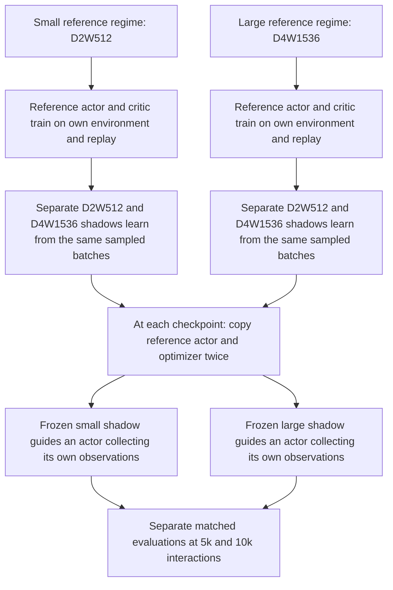

> **Current status:** An opt-in implementation of the [revised pilot specification](online_exp2_revision_spec_20261110.md) now exists alongside the older one-update CPU development path described below. The pilot needs full-size GPU qualification and explicit scientific settings before launch.

## Revised online pilot candidate (10 November 2026)

The two regimes are separate runs. Within a regime, only the reference critic updates the live actor and only that actor collects main experience. The shadows share each reference replay batch and one sampled reference-policy next action, but maintain independent parameters, targets and optimizers. At each checkpoint, the two diagnostic actors start from the same reference actor and optimizer state. Their critics, temperature and normalization are frozen. Each actor collects its own interactions, samples uniformly with replacement from *its own new pre-action observations*, and applies the source `update_actor` loss and the trainer's fractional actor-update cadence. Diagnostic reward is recorded as an environment outcome; no critic learns from those rewards, and no diagnostic observation enters reference replay.

The pilot horizon is 10,000 actor–environment interactions per branch, with isolated matched evaluations at 0, 5,000 and 10,000. The 0 evaluation is the unchanged reference actor. Evaluation environments and RNG are separate from learning. Each adaptation episode starts in a new environment with a deterministic seed shared by the two branches for that episode number; their trajectories may diverge. The interpretation includes actor guidance and its behavioral feedback; future state distributions are not held identical. Results at 5,000 and 10,000 are reported separately. A positive large-minus-small return contrast may still mean that both actors deteriorated relative to baseline.

Profiles `online_exp2_pilot_reference_small.yaml` and `online_exp2_pilot_reference_large.yaml` select the two reference architectures. Both retain explicit nulls for environment/task population, training seeds, reference-training budget, checkpoints, evaluation episodes/mode, analysis choice and GPU-hour cap. The user must set those before either profile passes validation. The `run_role: pilot` gate prevents accidental use as an Exp1 or confirmatory run. Production horizon remains unresolved and is not inferred from pilot results.

Artifacts: `online_exp2.jsonl` records per-episode baseline, small and large returns; baseline-relative changes; large-minus-small contrast; regime, seed, checkpoint, horizon, source/config hashes, critic hashes, seed schedules, counters and policy action change. `diagnostics/step_*/progress.pkl` retains branch actors and optimizer states, branch-local observation histories, sample indices, per-update gradient/update norms, adaptation episodes, RNG and environment replay state for restart. `failure.json` records diagnostic exceptions. `analysis.json` contains episode means by checkpoint and horizon for one independent training run. `combine_pilot_analyses` accepts only matched environment/seed/checkpoint/horizon coverage and weights the two regimes equally. `probes/*.npz` continues to hold the established trained/fresh plasticity curves from common reference replay. Branch data never feed the assay. Probe output is a plasticity measure, not a substitute for return or Q accuracy.

The pilot's source actor cadence is `Exp12Trainer.train`'s fractional `update_counter`: after each sampleable interaction it accumulates `updates_per_interaction_step`, consumes whole updates, and carries the remainder. `SACAgent._sac_update` calls `update_actor` once per consumed learner update. The branch begins at the checkpoint carry, samples as soon as its first observation is collected, and needs no unique full batch or random-action warmup. The source trainer processes all reference updates in a UTD block through a scan. In pilot mode, the scan also returns the actor and temperature state *after their updates* for each batch: those are the states the source critic uses for its target. Each shadow pair evaluates that batch's corresponding policy and temperature. This read-only output leaves the reference update path unchanged in the controlled CPU fixture. The older one-update development path retains its block-boundary shadow snapshot.

GPU qualification remains necessary because this revision adds full-sized frozen-critic actor updates, 20,000 extra environment interactions per checkpoint, isolated evaluations, and replay-based branch restore. CPU fixtures establish behavior and restart mechanics but cannot establish T4 memory, throughput, or full 10,000-step stability. Resource hours cannot be estimated reliably until that timed qualification is measured.

For planning, each selected checkpoint adds **20,000 diagnostic environment interactions**, **5 × evaluation_episodes full episodes** (one baseline plus two branches at two horizons), and, if probed, **40,000 disposable critic fitting updates** (two shadows × ten rounds × 2,000). Multiply by selected checkpoints and independent runs. Raw simulator steps are counted from executed action repeats because a repeat can end early at a terminal state. These counts are exact work units, not GPU-hour estimates. A timed full-size qualification must supply throughput and memory before choosing the resource cap. The configured cap is checked in conservative device-seconds between training/diagnostic interactions and before/after probes; an individual long evaluation episode or probe may overrun it, so a timed qualification is still required.

## Historical one-update development path

# Proposed online reference-policy Experiment 2 prototype

Status: opt-in CPU prototype, **not a frozen scientific protocol or GPU launch**.
Source starting reference: `22e1666f0ff680699b06ded1ce70ec0962f9c103` (official Exp1 candidate). The actual small and large Exp1 jobs may have distinct source SHAs. This prototype does not alter the historical injection/fork Exp2 or the immutable-replay PR26 design.

## Question and design

An independent reference SimBa-SAC agent owns online collection, replay, observation normalization, actor, critic, target, temperature, and training RNG. Fresh D2W512 and D4W1536 shadow critics learn from each newly sampled reference replay batch. Neither shadow has a live actor or writes reference state. At selected checkpoints, copies of the reference actor and its optimizer state take one SAC actor step against each frozen shadow critic, then the unchanged actor and both copies are evaluated on matched episode seeds. The copies are discarded. This measures a local actor-guidance contrast under one reference trajectory; it does not measure eventual return after replacing the live critic.

The reference critic architecture, tasks/seeds, interaction budget, checkpoints, episode count/mode, analysis aggregate, and resource cap are deliberately null in `configs/base_online_exp2.yaml`. `validate()` rejects missing values. Only tiny `run_role=dev` fixtures may override the shadow architecture/probe size. Production retains the official probe constants and fails if they differ. No runner submits a job.

## Audited source symbols

| Concern | Source symbols and role |
|---|---|
| Actor and sampling | `SACActor`, `SACAgent.sample_actions`, `_sample_sac_actions`; training samples policy actions, evaluation uses temperature 0 in the source path. |
| Critic/targets | `SACCritic` or `SACClippedDoubleCritic`, `sac_update.update_critic`, `update_target_network`; separate target Q, source `(1-terminated)` bootstrap mask, and Polyak update. |
| Optimizers/temperature | `_init_sac_networks` builds AdamW actor/critic and temperature trainers; `_sac_update` orders actor, temperature, critic and target updates. `Trainer.apply_gradient` owns moments and parameter updates. |
| Replay/normalization | `NpyUniformBuffer.sample` selects uniform indices; `ObservationNormalizer.update_many` normalizes both observation fields from one RMS snapshot. The optional `return_indices` path records IDs without changing draws. |
| Environment/evaluation | `exp12.envs.create_envs`, `create_eval_env`, `ExactRestore`; `Exp12Trainer.evaluate_episodes` supplies the ordinary reference evaluation. Prototype evaluations use separate instances and matched seeds. |
| State | `Exp12Trainer.save/restore` and `exp12.state.commit_state_dir` persist the reference agent, replay, RMS, RNG and environment. The new `before_commit` hook stores shadow state in the same uncommitted directory. |
| Probe | `probe.run_probe`, `probe_round`, `_fit`, `summarize` through `run_probe_networks`; each shadow uses its own critic-shaped teacher and exact saved fresh parameters. |

The reference trainer samples all batches for a UTD block, then the shadow callback reads the same batches and a single reference actor/temperature/normalizer snapshot at that block boundary. It draws one next action and log probability per batch, updates both shadows with their own target Q, then the ordinary scanned reference update runs. The callback uses independent JAX/NumPy diagnostic streams. A controlled CPU fixture compares the resulting reference actor, critic, RNG and replay with the ordinary trainer. Shadow updates retain the source critic MSE, termination mask, AdamW and target update rule. Truncation remains bootstrap-eligible as in source.

## Outputs and restart

`online_exp2.jsonl` contains update indices, batch and target-policy hashes, shadow losses/Q-target summaries, episode-level returns and contrasts, intervention metrics, and probe artifact references. `interventions/step_*.npz` retains raw flattened actor gradients, realized parameter deltas, action panels and their observation indices. `probes/{small,large}_*.npz` retains per-round scores, full-pool losses and curves. `analysis.json` contains one equal-checkpoint run summary. The existing trainer logs retain the reference return trajectory. Each committed state includes `online_exp2.msgpack` and a SHA-256 manifest beside the complete reference state; restore rejects a mismatched configuration, source bytes or damaged shadow payload. Completed checkpoint diagnostics are represented in the saved ledger and are not rerun on resume.

Both shadow probes use the same replay-pool seed and indexing. Each architecture retains its own teacher and its trained/fresh pairing, as in the existing assay.

Run-level analysis should first average `advantage_large` over matched episodes at each checkpoint, then weight scheduled checkpoints equally within the independent reference-training run. Keep environments separate and retain every raw episode/check/round. Gradient cosine is undefined when either norm is zero. These outcomes are not proof of gradient correctness, Q truth or a causal plasticity mechanism.

## CPU use and limits

The entry point is `python run.py --experiment online_exp2_prototype --config_name base_online_exp2 --checkpoint_dir /absolute/new/path --overrides ...`. It fails on unset scientific fields. The test fixture uses small explicit settings and a deterministic synthetic environment. It exercises online updates, fresh probe, actor intervention, matched evaluation, saved artifacts and restore. Before any GPU pilot: freeze the null fields, verify source-bound full-size probe parity and real environment reset/seed behavior, run long checkpoint/restart identity, inspect per-process memory/throughput and storage, then obtain a separate resource/launch decision. No resource cost has been measured by this CPU fixture. The literature named in the owner brief informs the design but does not replace pinned source semantics or establish this prototype's correctness.
