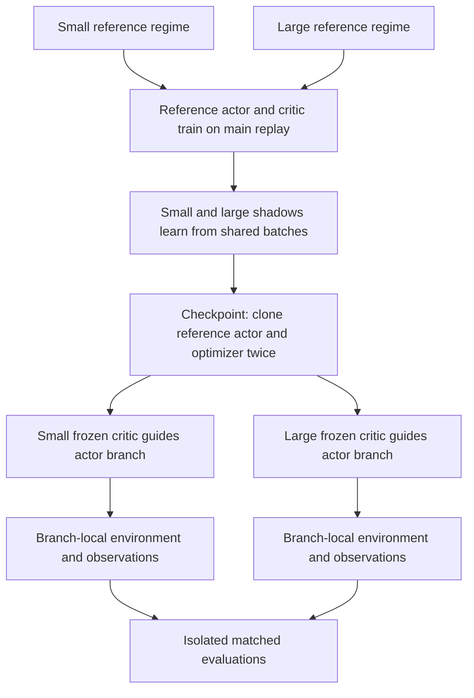

# Requested Experiment 2 pilot revision

**Implementation status: pilot candidate implemented, GPU qualification pending.** The new pilot mode is separate from the historical one-update development path. Its full-sized 10,000-interaction branches have not yet been qualified on GPU; the configuration retains explicit launch gates. See [the active implementation notes](online_exp2_prototype.md).

## Architecture intended by the owner

The diagram describes two separately instantiated regimes; it does not imply shared replay across them. Diagnostic branches do not feed the reference run.

## Source-derived actor cadence

`Exp12Trainer.train` adds `cfg.updates_per_interaction_step` to a fractional `update_counter` after each sampleable reference interaction, consumes whole updates while the counter is at least one, and retains the remainder. `SACAgent._sac_update` calls `update_actor` once per learner update; action repeat affects raw simulator steps, not this accumulator. The revised branch must snapshot and preserve the appropriate carry and copied actor optimizer counters.

## Owner change specification

Task: revise the existing Experiment 2 implementation
Implement the changes below to the current Experiment 2 design.

This is a change specification, not a request to redesign Experiment 1 or replace the existing project’s SAC implementation. Preserve existing scientific semantics unless explicitly changed here.

The updated experiment has:

Two reference-critic regimes.

Two shadow critics within each regime.

Repeated actor-only optimization against frozen shadow critics at checkpoints.

Each diagnostic actor collecting its own new environment interactions.

Actor updates using observations sampled from its own newly collected diagnostic observations.

No shared-checkpoint-replay diagnostic variant.

Implement and test the changes. Do not launch the production campaign or invent unresolved resource budgets, task selections, or checkpoint schedules.

1. Scientific objective and interpretation
The checkpoint diagnostic asks:

Starting from the same actor and actor optimizer state, which frozen shadow critic supports better actor improvement over a bounded sequence of new environment interactions?

The actor is allowed to benefit from reaching better states. Consequently, the actors’ subsequent observations and actions may diverge.

This is intentional. The diagnostic measures frozen-critic guidance together with the behavioral feedback induced by that guidance.

It does not hold future state distributions identical, and it must not be described as doing so.

The two reference regimes ask:

Does this small-versus-large shadow-critic comparison depend on the critic architecture that generated the reference learning trajectory?

Do not claim that averaging regimes eliminates all collector dependence or produces an architecture-neutral result.

2. Preserve the existing reference/shadow separation
Within each reference regime, maintain:

One live reference actor.

One reference critic, with source-compatible target-network structure.

One small shadow critic.

One large shadow critic.

One reference replay buffer.

Reference-owned normalization and temperature state.

Only the reference critic updates the live reference actor.

Only the live reference actor collects the main training experience.

The shadow critics train on that experience but never modify:

The reference actor.

Reference optimizer or temperature.

Reference normalization.

Reference environment.

Reference replay insertion.

Reference RNG progression.

The shadows do not need to compute hypothetical actor updates during ordinary training. Their actor-guidance role is exercised only in checkpoint diagnostics.

3. Add two reference regimes
Implement these regimes:

text
reference_small:
    reference critic architecture = D2W512
    small shadow architecture     = D2W512
    large shadow architecture     = D4W1536

reference_large:
    reference critic architecture = D4W1536
    small shadow architecture     = D2W512
    large shadow architecture     = D4W1536
The reference actor architecture remains the existing fixed architecture in both regimes.

The reference critic and a same-sized shadow critic are separate learning objects. Do not share parameters, targets, optimizer state, or RNG state merely because their architectures match.

Each regime is a separate reference-training trajectory with its own replay, learner states, environments, and diagnostic branches.

Both shadows within one regime receive identical experience. Experience is not expected to match across reference regimes once their policies diverge.

Where compatible, pair runs across regimes using the same training-seed labels, actor initialization rules, environment settings, and evaluation-seed schedules. Do not claim identical trajectories across regimes.

4. Shadow training must evaluate the current reference policy
During regular training:

Sample one shared transition batch for the two shadows.

Use one common reference-policy snapshot.

Use the same reference temperature and observation preprocessing.

Sample next-action policy noise once.

Compute reference-policy next actions and log probabilities once.

Supply those shared quantities to both shadow updates.

Let each shadow bootstrap through its own target network.

Update the shadows using source-compatible critic losses and target-update rules.

Conceptually:

𝑦
𝑖
=
𝑟
+
𝛾
𝑚
[
𝑄
𝑖
−
(
𝑠
′
,
𝑎
′
)
−
𝛼
r
e
f
log
⁡
𝜋
r
e
f
(
𝑎
′
∣
𝑠
′
)
]
,
𝑎
′
∼
𝜋
r
e
f
.
y
i
​
 =r+γm[Q
i
−
​
 (s
′
 ,a
′
 )−α
ref
​
 logπ
ref
​
 (a
′
 ∣s
′
 )],a
′
 ∼π
ref
​
 .
Preserve the actual implementation’s masking, reductions, reward processing, precision, and critic structure.

Do not force the numerical targets to match. The target values can differ because the shadow target networks differ.

Do not use the reference critic as a common value teacher.

Do not train either shadow as though it has an independently evolving live actor during main training.

5. Replace the one-update primary diagnostic
The primary checkpoint diagnostic is now repeated actor optimization with a frozen shadow critic.

At checkpoint
𝑡
t, take a coherent snapshot of:

Reference actor parameters.

Reference actor optimizer state and counters.

Reference temperature.

Reference normalization.

Both shadow critics.

Required source/config identifiers.

Dedicated diagnostic RNG state.

Create two diagnostic branches:

text
branch_small:
    actor starts from reference actor snapshot
    actor optimizer starts from reference optimizer snapshot
    critic = frozen small shadow checkpoint

branch_large:
    actor starts from identical reference actor snapshot
    actor optimizer starts from identical reference optimizer snapshot
    critic = frozen large shadow checkpoint
Copy the normalizer and temperature for read-only use.

Do not initialize either actor from an earlier diagnostic actor.

Do not carry diagnostic actor parameters or optimizer history between checkpoints.

The one-step diagnostic may remain as an optional labeled debug measurement if inexpensive, but it is not the primary endpoint and must not be substituted for the repeated-update test.

6. Freeze everything except the diagnostic actors
During each diagnostic branch:

Update:

Actor parameters.

That actor’s copied optimizer state.

Its branch-local observation buffer.

Its environment and branch-specific RNG state.

Do not update:

Shadow critic parameters.

Shadow target networks.

Shadow critic optimizer state.

Temperature.

Observation-normalization statistics.

Any main reference-training state.

Freeze critic parameters while retaining derivatives through the critic with respect to the actor’s actions.

Do not stop-gradient the entire Q output in the actor objective. That would remove the critic-derived actor signal.

Use the existing source-compatible actor loss, including its action transformations and entropy term.

Because the reference actor’s optimizer state is copied, historical optimizer moments influence the resulting updates. This is intentional: the test begins from the actual reference learning state.

7. Each branch collects its own new interactions
Each diagnostic actor interacts with its own environment instance:

text
current diagnostic actor
    → choose action
    → environment transition
    → record return and new observation
    → actor update when scheduled
    → repeat
The branches receive matched initial environment seeds and reset-seed schedules, but their resulting trajectories may differ.

Do not force matching states or actions after divergence.

Do not use the reference actor to collect their diagnostic observations.

Do not send diagnostic transitions back to the reference replay.

No reward-based critic learning occurs in this diagnostic. Rewards are recorded as environment outcomes; the actor continues to learn through the frozen critic’s gradients.

Document this distinction explicitly in the methodology.

8. Implement branch-local new-observation sampling
Use a separate observation buffer in each branch.

Requirements:

Start empty at the checkpoint.

Store observations collected by that branch only.

Do not preload reference replay.

Do not combine observations from the two branches.

Sample actor-update observation batches uniformly with replacement from observations collected so far.

Retain all branch observations over the bounded diagnostic horizon.

Do not silently introduce a sliding window or recency weighting.

Store the pre-action observation
𝑠
𝑡
s
t
​
  for each interaction. Avoid accidentally using a reset observation in place of a terminal observation.

Store raw observations and apply the checkpoint-frozen normalizer at the actor/critic input boundary, unless the existing implementation requires an equivalent explicitly tested representation.

Startup rule
Do not introduce a new random-action warmup: the actor is already trained.

The observation buffer starts empty, so uniform sampling with replacement is allowed once at least one observation is available.

Actor updates begin at the first source-compatible update opportunity after an observation is collected. If the existing scheduler requires a different startup behavior, identify and document the discrepancy before silently changing it.

Do not delay learning until a full unique batch is available unless that additional rule is explicitly approved.

9. Match actor update cadence to regular training
Use the actual actor-update schedule from regular training.

Do not infer actor updates per interaction merely from a configuration field named UTD. Inspect how critic updates, actor delays, action repeat, and scheduler counters interact in the selected source.

Preserve:

Actor batch size.

Actor optimizer settings.

Actor update frequency.

Delayed-update behavior, if present.

Learning-rate schedule semantics.

Source-compatible action sampling.

Both branches must execute the same number of scheduled actor updates over the same interaction horizon.

The absence of critic training must not accidentally change how often actor updates occur.

Log:

Actor–environment interactions.

Raw simulator steps.

Actor optimizer updates.

The realized actor-updates-per-interaction ratio.

10. Pilot horizon and evaluations
Implement a pilot diagnostic horizon of 10,000 actor–environment interactions per branch.

Required measurement points:

text
0 interactions: unchanged reference actor baseline
5,000 interactions: actor snapshots
10,000 interactions: actor snapshots
Allow additional explicitly configured intermediate measurements.

These are interactions, not raw simulator steps or optimizer updates.

Production horizon remains unresolved. Do not automatically set production to 5k because a favorable difference appears there.

Pilot-based production selection must consider:

Evaluation precision.

Runtime.

Policy drift.

Stability.

Whether extending the horizon materially changes interpretation.

Freeze the production choice before independent production runs.

11. Separate adaptation trajectories from evaluation episodes
Record the diagnostic learning trajectories’ rewards, but do not rely on them alone to compare policy quality.

At scheduled measurement points:

Snapshot the current diagnostic actor.

Evaluate it in separate environments.

Perform no learning during evaluation.

Use matched evaluation-seed schedules for the two branches.

Keep normalization frozen.

Do not insert evaluation observations into diagnostic buffers.

Do not consume branch-learning or reference-training RNG.

Resume branch learning from unchanged branch state.

Use the project’s established deterministic-versus-stochastic evaluation convention, making it explicit in configuration and artifacts. Do not silently change the convention.

If stochastic evaluation is used, pair policy-noise streams where feasible without claiming trajectories remain identical.

Save baseline evaluation returns for the unchanged checkpoint reference actor using the same evaluation-seed schedule.

12. Metrics: compare within each regime first
For reference regime
𝑟
r, checkpoint
𝑡
t, seed
𝑘
k, and diagnostic horizon
ℎ
h, define:

Δ
𝐽
𝑆
,
𝑟
,
𝑘
,
𝑡
(
ℎ
)
=
𝐽
𝑆
,
𝑟
,
𝑘
,
𝑡
(
ℎ
)
−
𝐽
𝐵
,
𝑟
,
𝑘
,
𝑡
(
0
)
,
ΔJ
S,r,k,t
​
 (h)=J
S,r,k,t
​
 (h)−J
B,r,k,t
​
 (0),
Δ
𝐽
𝐿
,
𝑟
,
𝑘
,
𝑡
(
ℎ
)
=
𝐽
𝐿
,
𝑟
,
𝑘
,
𝑡
(
ℎ
)
−
𝐽
𝐵
,
𝑟
,
𝑘
,
𝑡
(
0
)
.
ΔJ
L,r,k,t
​
 (h)=J
L,r,k,t
​
 (h)−J
B,r,k,t
​
 (0).
The primary comparative contrast is:

𝐴
𝑟
,
𝑘
,
𝑡
(
ℎ
)
=
Δ
𝐽
𝐿
,
𝑟
,
𝑘
,
𝑡
(
ℎ
)
−
Δ
𝐽
𝑆
,
𝑟
,
𝑘
,
𝑡
(
ℎ
)
.
A
r,k,t
​
 (h)=ΔJ
L,r,k,t
​
 (h)−ΔJ
S,r,k,t
​
 (h).
Save raw episode-level values before averaging.

Positive
𝐴
A means the large-shadow-guided actor performs better at that diagnostic horizon. It does not necessarily mean either actor improved relative to baseline.

Always distinguish:

Both improve.

Only one improves.

Both deteriorate, with one deteriorating less.

Report 5k and 10k pilot results separately.

13. Compare reference regimes without hiding disagreement
First report:

text
small-reference regime: small-shadow versus large-shadow contrast
large-reference regime: small-shadow versus large-shadow contrast
Then calculate a reference-regime sensitivity contrast:

𝐼
𝑘
(
ℎ
)
=
𝐴
ˉ
l
a
r
g
e
−
r
e
f
,
𝑘
(
ℎ
)
−
𝐴
ˉ
s
m
a
l
l
−
r
e
f
,
𝑘
(
ℎ
)
,
I
k
​
 (h)=
A
ˉ

large−ref,k
​
 (h)−
A
ˉ

small−ref,k
​
 (h),
where the checkpoint aggregation defining
𝐴
ˉ
A
ˉ
  is prespecified.

An optional equal-weight summary is:

𝑀
𝑘
(
ℎ
)
=
𝐴
ˉ
s
m
a
l
l
−
r
e
f
,
𝑘
(
ℎ
)
+
𝐴
ˉ
l
a
r
g
e
−
r
e
f
,
𝑘
(
ℎ
)
2
.
M
k
​
 (h)=
2
A
ˉ

small−ref,k
​
 (h)+
A
ˉ

large−ref,k
​
 (h)
​
 .
Do not:

Pool all episodes across regimes as independent observations.

Let a regime with more completed evaluations receive more weight accidentally.

Hide a sign reversal behind an overall mean.

Average raw rewards across unrelated environments.

Describe a nonsignificant regime difference as proof of equivalence.

Independent training seed/run is the primary replication unit. Checkpoints and diagnostic episodes are repeated measurements.

14. Preserve the existing plasticity assay
Run the established plasticity probe on disposable copies of the checkpoint critics.

Preserve the source implementation’s:

Ten target rounds.

2,000 continuous fitting updates.

Replay observation/action pool.

Teacher construction.

Own-mean offsets.

Fresh-reference handling.

Optimizer reset behavior.

Full-pool endpoint evaluation.

Raw fitting curves and round-level outputs.

Both shadow critics use the common main-training replay pool at that checkpoint for the probe—not their diagnostic branches’ diverged buffers.

Maintain architecture-specific trained/fresh pairing. Do not force identical teacher outputs across architectures if that changes the original assay.

Actor diagnostics and plasticity probes must refer to the same untouched critic checkpoint.

Do not use probe-fitted parameters in any actor diagnostic.

Do not describe measured plasticity as equivalent to Q accuracy or policy-update quality.

15. Diagnostic logs and isolation
Save at minimum:

text
reference regime
training seed
training checkpoint
source SHA and config hash
reference actor snapshot hash
actor optimizer snapshot hash
shadow architecture and checkpoint hash
temperature and normalizer identifiers
diagnostic environment seed schedules
evaluation seed schedules
interaction and optimizer-update counters
observation sampling indices or reproducible sampler state
actor gradient norms
actual actor parameter-update norms
policy/action change measurements
episode returns, lengths, success, termination/truncation
baseline-relative and large-minus-small return contrasts
probe raw scores and curves
NaN/Inf events and diagnostic failures
Keep RNG streams separate for:

Main reference training.

Shadow training.

Diagnostic collection.

Observation sampling.

Actor action sampling.

Evaluation.

Plasticity probes.

Enabling or disabling diagnostics must not alter the main reference-training trajectory in a controlled deterministic test.

Do not advance the reference environment while running diagnostic branches unless the implementation explicitly preserves checkpoint consistency and training isolation.

16. Tests required for these changes
Add tests for:

Both reference regimes instantiate the correct architecture roles.

Reference critic and same-sized shadow have independent state.

Shadows receive identical training batches and target-policy samples.

Shadows evaluate the correct reference policy.

Diagnostic actors and optimizer states are identical at branch start.

Critics, targets, temperature, and normalizer remain unchanged throughout diagnostics.

Actor gradients pass through Q with respect to actions.

Branch buffers begin empty and contain only that branch’s observations.

Sampling is uniform with replacement and startup behavior is explicit.

Reference replay never receives diagnostic or evaluation transitions.

Evaluation observations do not enter branch buffers.

Actor update counts match the source-derived schedule.

Evaluation does not modify branch-learning state or RNG.

Diagnostics do not modify reference-training state or RNG.

Same-architecture/same-state diagnostic fixtures reproduce the same updates under matched deterministic inputs.

Save/resume reproduces observation sampling and future actor updates.

Baseline-relative and between-critic metrics are calculated correctly.

Reference-regime averaging uses explicit equal weights.

Probe parity is maintained.

Invalid outputs are reported rather than silently clipped away.

17. Update the diagrams and methodology
Revise the existing graphs to show:

text
Two separate reference regimes
    ↓
Within each regime:
reference critic → reference actor → environment → reference replay
                                                ↓
                                      both shadow critics
                                                ↓
At checkpoint:
identical actor/optimizer copies
    ├─ frozen small shadow → own interaction → own observations
    └─ frozen large shadow → own interaction → own observations
                                                ↓
                              actor-only repeated optimization
                                                ↓
                              isolated matched policy evaluations
Make these visual distinctions clear:

Main training versus checkpoint diagnostics.

Trainable versus frozen components.

Shared experience during main shadow training.

Divergent branch experience during diagnostics.

No feedback from diagnostics to the reference run.

Update the current active Experiment 2 documentation while preserving historical protocol descriptions and provenance.

18. Reference papers and implementation sources
Use the following references for specific methodological ideas, not as claims that the complete design already exists.

Optimistic critics can empower small actors

text
arXiv: 2506.01016
Relevant sections: 2, 2.1, 3.1
Use for:

Separating experience generation from receiving-agent learning.

Actor influence through both collection and critic targets.

Testing sensitivity to experience source.

Do not claim that it implements one shared critic with two live actors, or the exact two-regime frozen-critic diagnostic.

The Difficulty of Passive Learning in Deep Reinforcement Learning

text
arXiv: 2110.14020
Relevant material: tandem, forked tandem, architecture and data-source experiments
Use for:

Exact shared-batch controls.

Collector-distribution sensitivity.

Limitations of passive learning.

Off-Policy Actor-Critic with Shared Experience Replay

text
Schmitt, Hessel, Simonyan
ICML 2020
PMLR volume 119, schmitt20a
Use for:

Experience sharing across collectors.

Why mismatch requires explicit treatment.

Do not import V-trace corrections into SAC without a separately justified algorithm change.

Rethinking Population-assisted Off-policy Reinforcement Learning

text
arXiv: 2305.02949
Use for:

Separating experience sources.

Controlling buffer contribution.

Why observation-sampling distributions affect learning.

This paper is not authority for a particular diagnostic-buffer size in our experiment.

Schrödinger–Föllmer Actor–Critic

text
arXiv: 2609.33239
Use only as a related example of a frozen-critic actor-improvement block within an online learning procedure. Its actor and sampling methods differ from ours.

For internal implementation, inspect the actual source before using any symbol:

text
Repository: kaves29/scaling-drl-research

Selected Exp1 reference SHA:
22e1666f0ff680699b06ded1ce70ec0962f9c103

Known source-map paths:
AGENTS.md
main/.claude/methodology-exp1-exp2.md
main/docs/exp12_decisions.md
main/experiments/exp12/official_exp1.py
main/configs/base_exp1_official.yaml
main/experiments/exp12/probe.py
main/experiments/exp12/run_probes.py
Respect newer task-specific source decisions if verified. Do not substitute an arbitrary branch tip for a pinned source.

PR #26’s earlier fixed-data planner is not the trainer for this revised protocol. Reuse provenance utilities where appropriate, but do not inherit its immutable mixed-replay design.

19. Deliverables
Return:

A concise summary of changes from the current implementation.

Exact source symbols reused or modified.

Updated protocol documentation and diagrams.

Configurations for both reference regimes.

Frozen-critic diagnostic implementation.

Branch-local observation-buffer implementation.

Source-derived actor-update schedule verification.

Tests and actual results.

Metric and artifact schemas.

Pilot configuration with 5k and 10k measurements.

Remaining production decisions and resource estimates.

Any discrepancy between this specification and repository behavior.

Do not launch production jobs.

Unresolved settings must remain explicit: task/seed population, main-training budget, checkpoint frequency, evaluation episode counts, production diagnostic horizon, and resource cap.
